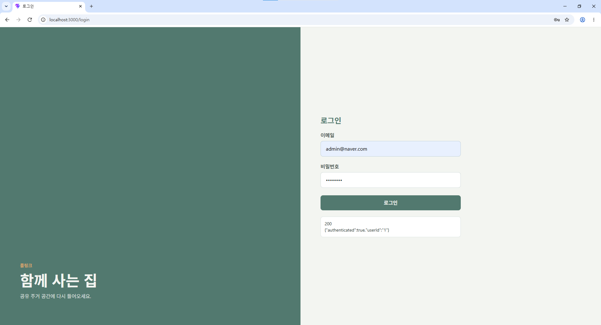

# 설치 가이드

coliving-platform 로컬 개발 환경을 준비하는 순서입니다.

## 1. Git 설치 (필수)

- 설치: https://git-scm.com/install/
- 참고: https://cafe.naver.com/f-e/cafes/28186338/articles/29528?boardtype=L&menuid=441&referrerAllArticles=false

참고 링크대로 Git을 설치합니다.
Git Bash에서 클론 받을 위치를 연 뒤 실행합니다.

```bash
git clone -b dev https://github.com/ibm05-team-3/coliving-platform.git
```

## 2. WSL + Docker Desktop 설치 (필수, 재시작 필요)

- 설치: https://docs.docker.com/desktop/setup/install/windows-install/
- 참고: https://cafe.naver.com/f-e/cafes/28186338/articles/31292?menuid=589&referrerAllArticles=false&page=2

1. 참고 링크대로 Docker Desktop을 설치합니다.
2. 필요하면 PC를 재시작합니다.
3. Docker Desktop을 실행하고 로그인합니다.
4. 터미널에서 `coliving-platform` 클론 폴더를 엽니다.
5. 인프라 컨테이너를 띄웁니다.

```powershell
docker compose up -d
```

## 3. DBeaver Community 설치 (대안 가능)

- 설치: https://dbeaver.io/
- 참고: https://cafe.naver.com/f-e/cafes/28186338/articles/22335?menuid=558&referrerAllArticles=false

1. 참고 링크대로 DBeaver를 설치합니다.
2. DBeaver를 실행합니다. Configure 설정은 모두 기본값으로 둡니다.
3. 새 데이터베이스 연결을 만듭니다.
4. PostgreSQL을 선택합니다.
5. PostgreSQL standard driver(맨 위)를 선택합니다.
6. Docker Desktop에서 `coliving-postgres`가 켜져 있는지 확인합니다.
7. Password에 `admin`을 입력합니다.
8. Database 항목 오른쪽의 **Show all databases**를 체크합니다.
9. **Test Connection**을 눌러 Connected가 나오면 완료합니다.
10. 클론 폴더의 `services\user-service\src\main\resources\db` \ `schema-dev.sql`을 DBeaver로 엽니다.
11. DBeaver의 Data Source를 `postgres`로 바꿉니다.
12. 아래 문장만 먼저 실행합니다.

```sql
CREATE DATABASE user_service ENCODING 'UTF8';
```

13. Schema를 `user_service`로 전환합니다.
14. `\c user_service;`를 제외한 아래쪽을 모두 실행합니다.

## 4. Eclipse Temurin JDK 21 설치 (대안 가능, Oracle JDK 가능)

- 설치: https://adoptium.net/temurin/releases/?version=21
- 참고: https://cafe.naver.com/f-e/cafes/28186338/articles/28297?boardtype=L&menuid=558&referrerAllArticles=false

1. 시작 메뉴에서 **환경 변수**를 검색하고 **시스템 환경 변수 편집**을 엽니다.
2. **환경 변수**를 클릭합니다.
3. 시스템 변수에서 새로 만듭니다.
   - 변수 이름: `JAVA_HOME`
   - 변수 값: 설치된 경로 (예: `C:\Program Files\Eclipse Adoptium\jdk-21.0.x.x-hotspot`)
4. `Path` 변수를 편집하고 `%JAVA_HOME%\bin`을 추가합니다.
5. 확인한 뒤 새 터미널에서 Java 버전을 확인합니다.

## 5. IntelliJ IDEA 설치 (대안 가능)

- 설치: https://www.jetbrains.com/idea/
- 참고: https://cafe.naver.com/withjasmine?iframe_url_utf8=%2Fca-fe%2Fcafes%2F28186338%2Farticles%2F31086%253FreferrerAllArticles%3Dfalse%2526menuid%3D466%2526boardtype%3DL%2526oldPath%3D%252FArticleRead.nhn%253FreferrerAllArticles%253Dfalse%2526menuid%253D466%2526boardtype%253DL%2526clubid%253D28186338%2526articleid%253D31086

1. 참고 링크대로 설치합니다.
2. IntelliJ IDEA를 실행하고 프로젝트 JDK를 설정합니다.
3. Docker에서 `coliving-platform` 컨테이너가 켜져 있는지 확인합니다.
4. 아래 순서대로 서비스를 실행합니다.

| 순서 | 서비스 | 포트 |
|------|--------|------|
| 1 | 1_EurekaApplication | 8761 |
| 2 | 2_ApiGatewayApplication | 8081 |
| 2 | 2_ConfigServerApplication | 8888 |
| 3 | 3_UserApplication | 8082 |

## 6. Node.js 설치 (필수)

- 설치: https://nodejs.org/en/download
- 참고: https://cafe.naver.com/f-e/cafes/28186338/articles/29630?menuid=464&referrerAllArticles=false
- 설치 버전: v22.23.3

1. 참고 링크대로 설치합니다.
2. 명령 프롬프트에서 `coliving-platform\frontends\user-web`으로 이동합니다.
3. 의존성을 설치하고 개발 서버를 실행합니다.

```powershell
npm i
npm run dev
```

4. http://localhost:5173/login 에 접속합니다.
5. 아래 계정으로 로그인합니다.
   - 아이디: `admin@naver.com`
   - 비밀번호: `12341234`
6. 응답에 `accessToken`과 `refreshToken`이 둘 다 있으면 정상입니다.



## 7. VS Code 설치 (선택)

- 설치: https://code.visualstudio.com/download?_exp_download=d53503e735
- 참고: https://cafe.naver.com/f-e/cafes/28186338/articles/31328?menuid=558&referrerAllArticles=false
- React 확장: https://cafe.naver.com/f-e/cafes/28186338/articles/29631?menuid=464&referrerAllArticles=false

## 8. Bruno 설치 (선택, Postman 가능)

- 설치: https://www.usebruno.com/
- 참고: https://cafe.naver.com/f-e/cafes/28186338/articles/29623?boardtype=L&menuid=464&referrerAllArticles=false

## 9. MongoDB Compass 설치

- 설치: https://www.mongodb.com/try/download/compass
- 참고: https://cafe.naver.com/f-e/cafes/28186338/articles/31732?menuid=563&referrerAllArticles=false
- 버전: MongoDB Compass 1.53.0 (Stable) GUI

## 10. GitHub Desktop 설치 (선택)

- 설치: https://desktop.github.com/download/
